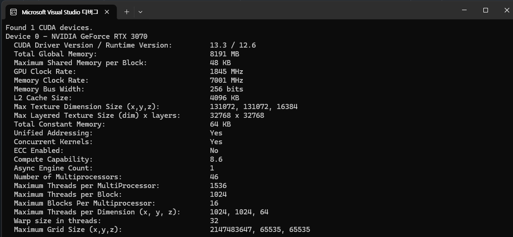

# DirectX 12 × CUDA Interop

DirectX 12로 렌더링한 텍스처를 CPU로 복사하지 않고 CUDA가 직접 처리하는 GPU 상호 운용(Interop) 프로젝트입니다. 동일한 Gaussian Blur를 Pixel Shader, Compute Shader, CUDA로 각각 구현하고 실행 중 결과와 성능을 비교할 수 있도록 구성했습니다.

> 이 프로젝트의 목표는 단순히 CUDA 커널을 호출하는 것이 아니라, 서로 다른 GPU API가 하나의 리소스를 안전하게 공유하는 렌더링 파이프라인을 직접 설계하고 검증하는 것입니다.

실행 영상: [D3D12-CUDA Interop 실제 동작 확인](https://www.youtube.com/watch?v=tXCfRhbCCkY)

## 핵심 결과

- D3D12 공유 텍스처를 CUDA External Memory로 가져와 CPU readback 없이 후처리
- D3D12 Fence를 CUDA External Semaphore로 연결하여 `DX12 → CUDA → DX12` 실행 순서 보장
- 동일한 separable Gaussian Blur를 Pixel Shader / Compute Shader / CUDA로 구현
- ImGui에서 렌더링 방식, Blur Radius, 반복 횟수를 실시간 변경
- FPS와 Delta Time을 표시하여 실행 경로와 연산량에 따른 변화를 확인
- 기존에 직접 설계한 D3D12 프로젝트를 기반으로 Codex를 적극 활용해 Interop 구조를 적용·리팩터링·검증

## 프로젝트를 만든 이유

일반적인 후처리는 그래픽스 또는 Compute Shader만으로도 구현할 수 있습니다. 하지만 CUDA 기반 연산을 렌더링 결과에 직접 연결하려면 두 API가 같은 GPU 리소스를 안전하게 공유해야 합니다. 이 프로젝트에서는 다음 질문에 답하는 것을 목표로 했습니다.

1. D3D12 텍스처를 CPU 복사 없이 CUDA에서 직접 읽고 쓸 수 있는가?
2. D3D12 Command Queue와 CUDA Stream의 실행 순서를 어떻게 보장할 것인가?
3. 같은 알고리즘을 서로 다른 GPU 경로로 구현했을 때 어떤 성능 차이가 발생하는가?
4. CUDA와 같은 범용 GPU 연산 장치를 향후 엔진의 어떤 영역에 활용할 수 있으며, 기존 Compute Shader 중심 구조와 비교했을 때 어떤 설계상 이점을 얻을 수 있는가?

네 번째 질문은 단순한 후처리 성능 비교보다 장기적인 목적을 담고 있습니다. 이미지 필터처럼 Graphics Pipeline과 밀접한 작업은 Compute Shader가 효율적이지만, 군중 시뮬레이션, 다수 캐릭터의 애니메이션 상태 판정, 상태 머신 갱신, 물리·AI 보조 연산처럼 렌더링 Resource 형태에 꼭 맞지 않는 대규모 병렬 작업도 존재합니다.

이 프로젝트는 D3D12-CUDA Interop을 먼저 구축함으로써 이러한 범용 연산을 GPU로 확장할 수 있는 가능성, 설계상의 이점, 데이터 이동 및 동기화 비용을 분석하기 위한 기반입니다.

## 개발 방식: 기존 엔진 설계 × Codex 협업

이 프로젝트는 빈 프로젝트에서 생성한 예제가 아닙니다. 기존에 직접 설계하고 개발해 온 D3D12 프로젝트의 프레임 파이프라인, Scene/Object 구조, Renderer, Shader/Material 구조를 기반으로 CUDA Interop 실험에 맞게 변형한 프로젝트입니다.

Codex는 개발 과정에서 적극적인 페어 프로그래밍 도구로 활용했습니다.

- 기존 코드베이스와 렌더링 흐름 분석
- D3D12-CUDA 공유 메모리 및 동기화 코드의 구현과 리팩터링 보조
- Pixel / Compute / CUDA 비교 경로를 기존 Scene 구조에 통합
- 오류 가능성이 있는 Resource State, Fence 순서, 수명 관리 검토
- 문서화, 실험 시나리오, 성능 측정 기준 정리

최종 설계 방향, 기능 범위, 코드 채택 여부, 디버깅과 실행 결과 검증은 개발자가 결정했습니다. 즉, 기존 엔진에 대한 이해와 판단을 바탕으로 Codex를 구현 속도와 검토 범위를 확장하는 도구로 사용했습니다. 사용 사실을 숨기기보다 어떤 부분에서 활용했고 결과를 어떻게 검증했는지를 투명하게 기록하는 것을 원칙으로 합니다.

## 실행 모드

| 모드 | 처리 경로 | 목적 |
|---|---|---|
| Default | D3D12 Render → Present | 후처리 전 기준 화면 |
| Pixel Shader | D3D12 Render → PS Blur → Present | Full-screen Pass 비교군 |
| Compute Shader | D3D12 Render → CS Blur → Present | D3D12 Compute 비교군 |
| CUDA | D3D12 Render → CUDA Blur → D3D12 Present | 외부 메모리 공유 및 동기화 검증 |

Blur Radius는 `0~20`, Blur Iterations는 `1~100` 범위에서 변경할 수 있습니다. 창 제목에는 FPS와 Delta Time을 표시해 부하 증가에 따른 변화를 확인합니다.

## 렌더링 파이프라인

```text
D3D12 Scene Render
        ↓
Shared RGBA8 Texture
        ↓  DX→CUDA Fence Signal / CUDA Wait
CopyTextureKernel
        ↓
Horizontal Blur ↔ Vertical Blur (Iterations)
        ↓  CUDA→DX Fence Signal / D3D12 Wait
Full-screen Pass → Swap Chain → Present
```

기본 프레임 흐름은 다음과 같습니다.

```text
Animate → OnPreRender → Render → OnPostRender → ImGui → Present
```

CUDA 모드에서는 `OnPostRender`에서 첫 Command List를 제출해 공유 텍스처의 렌더링 완료를 확정합니다. CUDA 처리가 끝난 뒤 별도의 Command Allocator로 Command List를 다시 기록해 결과를 출력합니다.

## 핵심 설계

### CPU를 거치지 않는 공유 텍스처

D3D12 텍스처를 `D3D12_HEAP_FLAG_SHARED`로 생성하고 Shared Handle을 발급합니다. CUDA는 `cudaImportExternalMemory`로 가져와 Mipmapped Array와 Surface Object로 매핑합니다.

**설계 의도**

- GPU → CPU → GPU 복사 제거
- 동일한 물리 GPU 메모리를 두 API가 사용
- CUDA 연산 결과를 D3D12가 바로 샘플링

### 방향을 분리한 GPU 동기화

화면 Present용 Fence와 Interop용 Fence의 역할을 분리하고, Interop에는 두 개의 단방향 Fence를 사용합니다.

- `DX → CUDA`: D3D12의 공유 텍스처 쓰기 완료
- `CUDA → DX`: CUDA 후처리 완료

D3D12 Fence를 CUDA External Semaphore로 가져와 Queue와 Stream 사이의 Wait / Signal 관계를 구성했습니다.

### 비교 가능한 동일 알고리즘

Gaussian Blur는 가로·세로 2-pass separable 방식입니다. Pixel Shader, Compute Shader, CUDA가 같은 Radius, Sigma 규칙, 반복 횟수를 사용합니다. CUDA 경로는 16×16 thread block을 사용합니다.

### 리소스 상태와 수명 관리

공유 텍스처는 Render Target, Common, Shader Resource 상태를 오가므로 단계별 Resource Barrier를 명시합니다. CUDA 객체는 생성의 역순으로 해제하며, Interop 클래스의 복사 생성과 대입을 금지해 외부 리소스의 중복 소유를 막았습니다.

## 클래스 구성

| 클래스 | 역할 |
|---|---|
| `CGameFramework` | D3D12 초기화, 프레임 루프, Queue/List, Swap Chain, FPS 표시 |
| `CScene` / `CMainScene` | 장면 관리, 후처리 방식 전환, CUDA 제출 흐름 제어 |
| `CDirectXCudaInterop` | 공유 메모리·Fence, CUDA Import, Queue/Stream 동기화, 커널 실행 |
| `CRenderer` | Pixel / Compute Shader Gaussian Blur와 리소스 전환 |
| `CGraphicsCommon` / `CGraphicsPSO` | Root Signature, Shader, PSO 공용 관리 |
| `CShader` / `CComputeShader` | 그래픽스 및 Compute Pipeline 바인딩 |
| `CTexture` | D3D12 Texture와 View용 리소스 관리 |
| `CPostProcessingObject` | 결과를 Swap Chain에 출력하는 Full-screen Pass |
| `CGameTimer` | Delta Time과 FPS 계산 |

## CUDA 커널

| 커널 | 역할 |
|---|---|
| `CopyTextureKernel` | 공유 텍스처를 CUDA 전용 원본 배열로 복사 |
| `GaussianBlurHorizontalKernel` | X축 Gaussian 가중합 |
| `GaussianBlurVerticalKernel` | Y축 Gaussian 가중합 후 공유 텍스처 기록 |
| `DirectXCudaInteropKernel` | 공유 버퍼 Interop 검증용 연산 |
| `CudaConsoleAddKernel` | 시작 시 CUDA 실행 환경 Smoke Test |

## 사용 기술 및 도구

| 구분 | 기술 / 도구 | 목적 |
|---|---|---|
| Language | C++14, CUDA C++, HLSL | 엔진, CUDA 커널, Shader 구현 |
| Graphics | DirectX 12, DXGI | 렌더링 파이프라인과 Swap Chain |
| GPU Compute | CUDA Runtime API 12.8 | 외부 메모리·세마포어와 커널 실행 |
| UI | Dear ImGui | 방식과 Blur 파라미터 실시간 제어 |
| Profiling | NVIDIA Nsight Systems / Compute | Timeline, 커널 시간, 병목 분석 |
| IDE / Build | Visual Studio 2022, MSVC v143, NVCC | Debug / Release x64 빌드 |
| AI Collaboration | OpenAI Codex | 코드베이스 분석, 구현·리팩터링 보조, 검토와 문서화 |

## 빌드 환경

### 요구 사항

- Windows 10/11 64-bit
- Visual Studio 2022, Desktop development with C++
- Windows SDK, CUDA Toolkit 12.8
- CUDA 지원 NVIDIA GPU와 호환 드라이버
- vcpkg `x64-windows` 환경의 Dear ImGui

### 개발 및 실행 PC의 CUDA 장치 정보

아래 정보는 이 프로젝트의 동작을 확인한 개발 PC에서 CUDA 장치 조회 프로그램을 실행한 결과입니다.

| 항목 | 값 |
|---|---|
| GPU | NVIDIA GeForce RTX 3070 |
| CUDA Driver API / Runtime | 13.3 / 12.6 |
| Compute Capability | 8.6 |
| Global Memory | 8,191 MB |
| Shared Memory per Block | 48 KB |
| Multiprocessors | 46 |
| Maximum Threads per Multiprocessor | 1,536 |
| Maximum Threads per Block | 1,024 |
| Warp Size | 32 |
| Memory Bus Width | 256-bit |



> 위 이미지는 실행 환경에서 조회한 장치 및 Runtime 정보입니다. 현재 Visual Studio 프로젝트의 CUDA Build Customization은 12.8을 기준으로 하므로, 다른 PC에서 빌드할 때는 설치된 Toolkit, 프로젝트 Build Customization, Driver 호환성을 함께 확인해야 합니다.

### 실행

1. `D3D12-CUDA-Interop.sln`을 Visual Studio에서 엽니다.
2. `x64`, `Debug` 또는 `Release`를 선택합니다.
3. CUDA 12.8 Build Customization과 vcpkg 경로를 확인합니다.
4. 빌드 후 `Render Settings`에서 실행 경로와 Blur 값을 변경합니다.

> 프로젝트 파일은 CUDA 12.8과 `$(USERPROFILE)\vcpkg\installed\x64-windows` 경로를 기준으로 합니다.

## 배운 점과 개선 방향

### 배운 점

- GPU API 연동에서는 메모리 공유보다 소유권과 실행 순서 설계가 더 중요했습니다.
- Fence의 방향과 책임을 분리하면 디버깅이 쉬워졌습니다.
- 평균 FPS만으로는 동기화 비용을 설명하기 어려워 Frame Time과 GPU Timeline이 함께 필요했습니다.
- AI 코딩 도구의 제안은 실행 결과가 아니므로, 기존 구조에 대한 이해와 빌드·실행·프로파일링 검증이 필수였습니다.

### Compute Shader와 CUDA 비교에서 얻은 설계 관점

현재의 Gaussian Blur 비교에서는 CUDA 경로의 성능이 Compute Shader보다 크게 낮았습니다. 이 결과는 CUDA 자체의 연산 성능이 항상 낮다는 의미라기보다, 단순 이미지 후처리에서는 DirectX 12 Graphics Pipeline에 이미 통합된 Compute Shader가 유리하다는 점을 보여줍니다.

CUDA 경로에는 외부 메모리 매핑, 원본 보존용 복사, D3D12 Queue와 CUDA Stream 사이의 동기화 비용이 추가됩니다. 현재 CUDA Kernel 역시 Shared Memory를 활용한 Tiling 최적화가 적용되지 않은 기준 구현입니다. 반면 Compute Shader는 D3D12 Texture와 Descriptor를 그대로 사용하므로 이미지 기반 후처리에서 Resource 연결 비용이 상대적으로 작습니다.

Compute Shader를 사용하려면 DirectX 12의 Resource, Descriptor Heap, Root Signature, Compute PSO에 맞춰 메모리를 생성하고 바인딩해야 합니다. 텍스처 기반 후처리는 입출력 형식이 명확하고 D3D12 Resource 구조와 잘 맞기 때문에 이 과정이 비교적 자연스럽습니다. 반면 렌더링과 직접 연결되지 않은 복잡한 일반 목적 데이터를 처리하려면 연산에 필요한 데이터까지 D3D12 Resource와 Descriptor 구조로 설계해야 하므로 데이터 배치와 Pipeline 구성이 빠르게 복잡해질 수 있습니다.

CUDA는 현재와 같은 단순 후처리에서는 Interop 비용 때문에 불리했지만, 일반 포인터 기반의 메모리 할당과 연산 모델을 제공한다는 장점이 있습니다. 향후 군중 제어, 여러 캐릭터의 애니메이션 상태 처리, 상태 머신 갱신, 대규모 판정처럼 렌더링 Pipeline과 느슨하게 결합된 병렬 작업에서는 필요한 데이터를 연산 목적에 맞게 구성하기가 더 편리할 수 있습니다.

따라서 이번 비교에서 얻은 결론은 `CUDA가 Compute Shader보다 빠르다`가 아닙니다. 이미지 후처리처럼 D3D12 Resource와 자연스럽게 연결되는 작업에는 Compute Shader를 우선하고, 복잡한 범용 데이터 구조와 독립적인 GPU 연산이 필요한 작업에는 CUDA를 검토하는 것이 적절하다는 설계 기준을 얻었습니다. 실제 채택 여부는 데이터 이동과 동기화 비용을 포함한 전체 Frame 기준으로 판단해야 합니다.

### 개선 방향

- Shared Memory 또는 타일 기반 CUDA 커널 최적화
- GPU Timestamp Query와 CSV 자동 벤치마크 추가
- Adapter LUID로 D3D12 Adapter와 CUDA Device 일치 자동 검증
- CUDA를 군중 제어, Animation 상태 처리, 상태 머신 등 범용 병렬 연산에 적용하는 실험
- 오류 시 프로세스 종료 대신 복구 가능한 오류 전달 구조 적용

## 주요 파일

- `DirectXCudaInterop.h/.cpp/.cu`: D3D12-CUDA 공유와 커널
- `MainScene.cpp`: 실행 방식 선택과 프레임 제출 순서
- `Renderer.cpp`: Pixel / Compute Shader Gaussian Blur
- `Shader/CS/BlurXCS.hlsl`, `BlurYCS.hlsl`: Compute Shader
- `Shader/PS/BlurXPS.hlsl`, `BlurYPS.hlsl`: Pixel Shader
